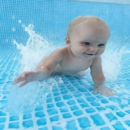
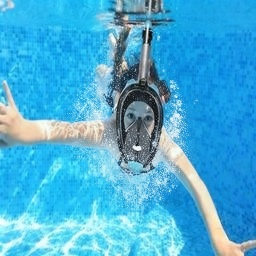
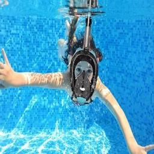

# UW-S
UW-S is a dataset designed for splash removal in dynamic underwater scenes. It provides paired input and target images, along with human masks for the training set to support human-aware supervision. The dataset is pre-divided into training, validation, and test sets.

- **Input:** images affected by splash interference.
- **Target:** corresponding reference images for restoration.
- **Mask (training set):** foreground masks used for human-aware training supervision.

## Training Examples

The following two training samples illustrate different human poses in underwater scenes.

| Sample ID | Input                                  | Target                                   | Human mask                           |
| --------- | -------------------------------------- | ---------------------------------------- | ------------------------------------ |
| 00315     |  |  |  |
| 00778     |  |  |  |